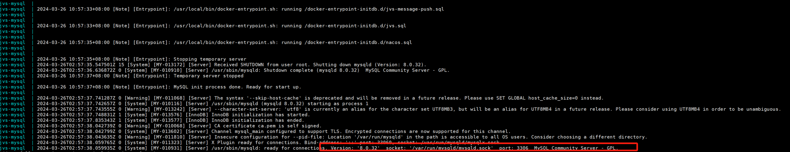

# jvs-aps（智能排产）


#### 在线体验地址：
https://aps.bctools.cn/   无需账号，扫码即可登录查看


#### 介绍
智能排产是针对工业企业提供的便捷的排产工具，目标：
1.  提高生产效率  
通过优化生产计划和调度，减少生产过程中的等待和空闲时间，提高设备的利用率。
2.  降低库存成本  
精确计算物料需求，减少不必要的提前采购，降低库存成本。
3.  提升客户满意度  
准确预估订单交期，提高准时交货率，提升客户满意度。
4.  优化资源配置  
综合考虑生产过程中的各种约束条件，实现资源的优化配置。
5.  专业化求解器
通过专业求解器对排产计划进行调优，得到最好的结果。

#### 软件逻辑架构
APS是连接企业资源计划（ERP）系统和制造执行系统（MES）的核心枢纽，为整个生产流程提供了智能化的计划与排程解决方案

整个系统的核心功能：
  


#### 项目特点：
- 智能优化（求解器）  
先进算法：采用遗传算法、模拟退火算法等先进的优化算法，实现全局最优的生产计划和调度。  
实时响应：能够实时响应市场需求、设备故障、物料短缺等变化，动态调整生产计划和调度。  

- 高度灵活性（）  
多品种、小批量生产：支持灵活应对产品种类的变化和订单量的波动。  
插单处理：能够快速响应紧急订单，依照已经制定的排程计划自动调整现有排程，减少对机台产线的影响。  

- 数据驱动  
丰富的数据分析和可视化工具：提供实时的数据分析和可视化工具，帮助企业管理层做出更明智的生产决策。  
系统集成：具有良好的系统集成能力和扩展性，可以与ERP、SCM、MES等其他管理系统无缝集成。  
#### 项目部署：
##### 1.环境准备

1.1 安装docker 和docker-compose （如已经安装可以跳过）
```
curl -C- -O --retry 3 https://bctools.cn/jvs-docker && chmod a+x jvs-docker && ./jvs-docker -I
```
1.2 安装git
```
yum install -y git
```
#####  2.部署项目
2.1 下载项目
```
git clone https://gitee.com/software-minister/jvs-aps.git && cd jvs-aps && chmod -R 777 data && chmod -R 777 mysql && chmod -R 644 data/mysqlcnf
```
2.2 替换服务器ip地址  
请将${ip}修改为本地服务器IP
```
sed -i -e 's/server-ip/${ip}/g'  ./mysql/nacos.sql 
```
例:
sed -i -e 's/server-ip/114.114.114.114/g'  ./mysql/nacos.sql  
2.3 部署数据库
```
docker-compose -f docker-compose-db.yml pull 
docker-compose -f docker-compose-db.yml up jvs-mysql 
```
初始化数据库的时候比较慢和主机性能相关，出现如图  
  
效果就可以 Ctrl+C 退出当前操作；继续下面的操作  
```
docker-compose -f docker-compose-db.yml  up -d
```
查看日志是否报错   
`docker-compose -f docker-compose-db.yml logs -f`      
2.4 查看nacos  
程序依赖nacos 请保证能正常访问nacos后再执行应用部署  
```
http://服务器ip:8848/nacos   
```
账号：nacos  
密码：nacos  
2.5 启动基础后台框架
```
docker-compose -f docker-compose-base.yml pull
docker-compose -f docker-compose-base.yml up -d
```
查看日志是否报错  
`docker-compose -f docker-compose-base.yml logs -f`  
2.6 APS服务
```
docker-compose -f docker-compose-aps.yml pull
docker-compose -f docker-compose-aps.yml up -d
```
查看日志是否报错   
`docker-compose -f docker-compose-aps.yml logs -f`

#####  3.访问地址   
3.1 访问后台（含开发套件）  
http://服务器ip:8088  
帐号：admin 密码: 123456  
3.2 访问APS
http://服务器ip:9998   
帐号：admin 密码: 123456  
3.3 nacos地址  
http://服务器ip:8848/nacos  
帐号：nacos 密码: nacos

#### 版本说明


#### 其他JVS推荐项目
 - 管理平台（含管理平台）：https://frame.bctools.cn/ 
 - 低代码套件（应用中心）：https://app.bctools.cn 
 - 数据智仓（数据分析平台）：http://bi.bctools.cn/  
 - AI套件：http://ai.bctools.cn/  
 - 企业文档：http://knowledge.bctools.cn/  
 - 企业计划（项目管理）：http://teamwork.bctools.cn/  
 - 规则引擎：http://rules.bctools.cn/  
 - 逻辑引擎：http://logic.bctools.cn/  
 - 视频会议：http://meeting.bctools.cn/  
 - 智能排产(APS)：https://aps.bctools.cn/  
 - 企业邮筒（Web邮箱客户端）：http://mailbox.bctools.cn/  

#### 技术社群
技术交流群  


加我私聊  


